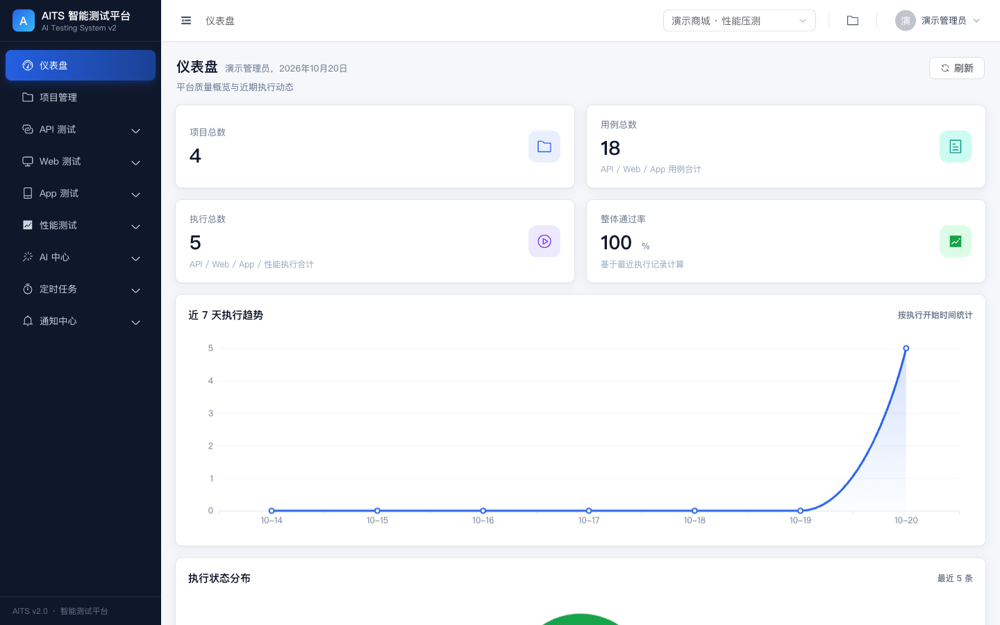
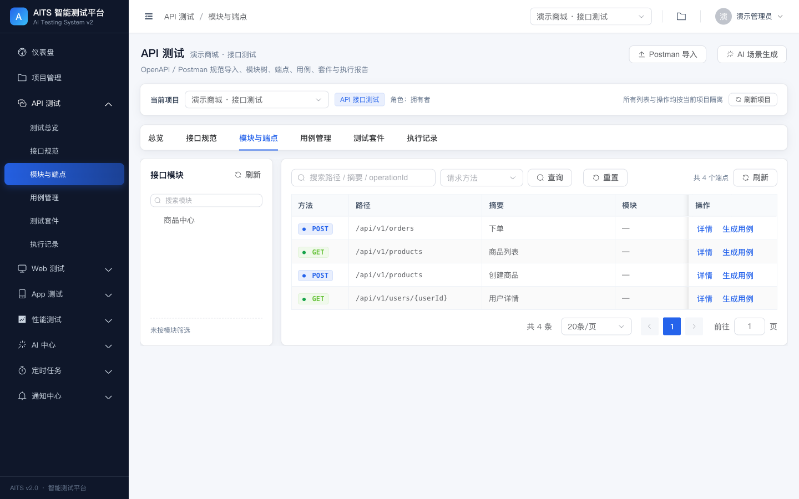
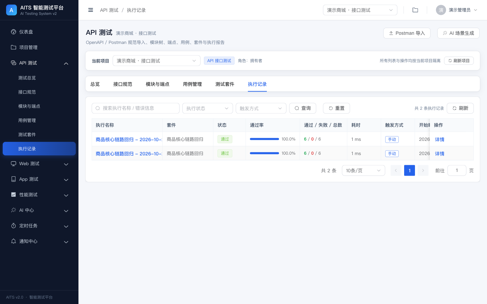
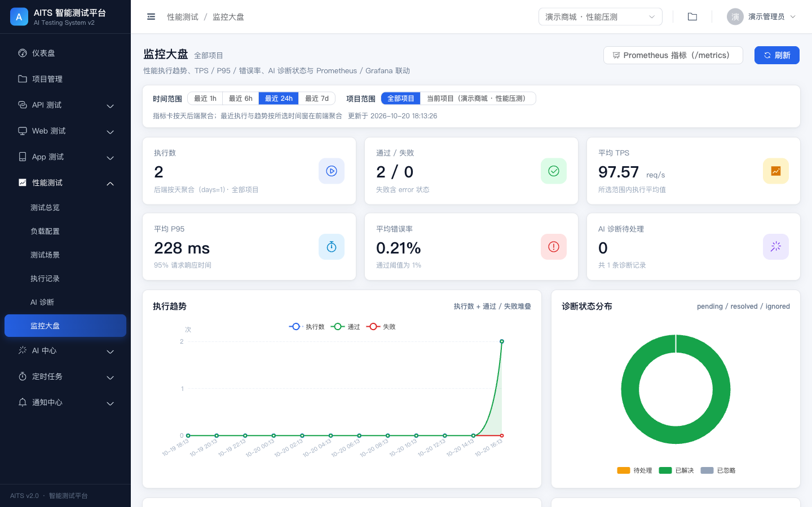
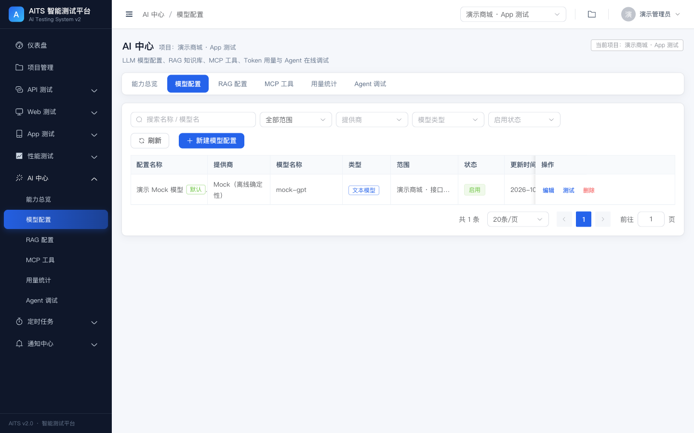
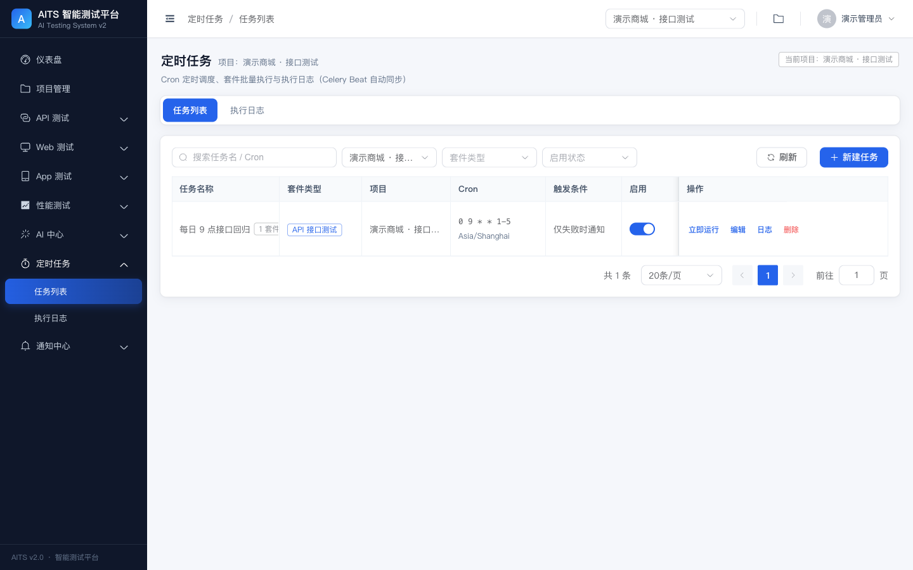

# AITS · AI-empowered Intelligent Testing System (v2)

面向软件测试全流程的 AI 赋能一体化测试平台：**API / Web UI / 移动端 App / 性能压测** 四大测试域，
LangGraph 多智能体编排、Django Channels 实时推送、Prometheus + Grafana 可观测、多渠道通知闭环。

设计文档：`docs/AITS设计文档V2.md` · 开发计划：`docs/DEVELOPMENT_PLAN.md` · 架构契约：`docs/ARCHITECTURE.md`

---

## 技术栈

| 层 | 技术 |
|---|---|
| 前端 | Vue 3.3 · Vite 5 · Element Plus 2.4 · Pinia 2 · Vue Router 4 · ECharts 5 |
| 后端 | Django 4.2 · DRF 3.14 · SimpleJWT · django-filter · drf-spectacular |
| 异步 / 实时 | Celery 5.3 · django-celery-beat · Channels 4 · ASGI (Uvicorn/Daphne) |
| AI | 双引擎编排（内置 StateGraph / LangGraph 1.0.5）· LangChain 胶水层（ChatOpenAI / Prompt / Parser / Embeddings / VectorStore / Tools）· RAG · MCP |
| 测试执行 | HttpRunner 兼容 YAML · Playwright · MidScene · Sonic · Locust |
| 数据 / 可观测 | SQLite/PostgreSQL · Redis · Prometheus · Grafana |

## 目录

```
backend/     Django 项目（9 个业务 app + common）
  aits_backend/     settings / urls / asgi / celery
  apps/             users projects api_testing web_testing app_testing
                    performance ai_core scheduled_tasks notifications common
  aits_monitor/     Prometheus + Grafana docker-compose 与配置
  utils/            prometheus File SD 等跨模块工具
frontend/    Vue 3 SPA
docs/        设计文档 / 开发计划 / 架构契约 / 验证报告
scripts/     dev.sh（一键启动）· verify.sh（一键验证）· smoke_api.py（端到端冒烟）
```

## 快速开始

```bash
# 1) 后端依赖（已预置 backend/.venv）
cd backend
python3 -m venv .venv && .venv/bin/pip install -r requirements.txt
# 可选：启用 LangGraph 编排 + LangChain 胶水层（不装则自动使用内置等价实现）
.venv/bin/pip install -r requirements-ai.txt


# 2) 迁移 + 创建管理员
.venv/bin/python manage.py migrate
.venv/bin/python manage.py createsuperuser

# 3) 启动
.venv/bin/python manage.py runserver 0.0.0.0:8000

# 4) 前端（另开终端）
cd frontend && pnpm install && pnpm dev
# 打开 http://127.0.0.1:5173
```

一键启动：`./scripts/dev.sh`　一键验证：`./scripts/verify.sh`

### 可选：Redis / 监控栈 / Sonic

```bash
# Redis（生产模式缓存 + Broker + Channel Layer）
redis-server --daemonize yes
export USE_REDIS=1

# Prometheus :9090 / Grafana :3000（admin/admin）
cd backend/aits_monitor && docker-compose up -d

# Sonic 移动端集群（可选，App 测试需要）
export SONIC_BASE_URL=http://127.0.0.1:3000 SONIC_USERNAME=... SONIC_PASSWORD=...
```

## 环境变量

见 `backend/aits_backend/settings.py` 顶部 env helper；常用项：

| 变量 | 默认 | 说明 |
|---|---|---|
| `AITS_ENV` | `dev` | `dev` / `test` / `prod`（test 自动 eager Celery + 内存通道） |
| `DJANGO_SECRET_KEY` | dev 占位 | 生产必须替换 |
| `DEBUG` | `True` | 生产置 `False` |
| `REDIS_URL` / `USE_REDIS` | `redis://127.0.0.1:6379/0` / 自动 | 缓存 / Broker / Channel Layer |
| `FRONTEND_BASE_URL` | `http://127.0.0.1:5173` | CORS / 通知报告链接 |
| `AITS_EXECUTION_MODE` | `simulated` | `real` 时启动 Playwright/Locust/HttpRunner 子进程 |
| `AITS_AGENT_ENGINE` | `auto` | `auto`（装了 LangGraph 就用）/ `builtin` / `langgraph` |
| `AITS_LLM_BACKEND` | `auto` | `auto`（装了 langchain-openai 就走 LangChain）/ `langchain` / `http` |
| `SONIC_BASE_URL` 等 | 空 | 移动端云真机集成 |
| `PROMETHEUS_SD_AUTO_UPDATE` | `True` | 自动维护 File SD 目标 |
| `GRAFANA_AI_NOTIFY_RECEIVER_ID` | 空 | AI 诊断默认通知接收人 |

## API 文档

后端启动后：`/api/docs/`（Swagger UI）、`/api/schema/`（OpenAPI）、`/api/redoc/`。
健康检查：`/health/`；指标：`/metrics/`。

## 首次运行（推荐）

```bash
cd backend
.venv/bin/python manage.py migrate
.venv/bin/python manage.py seed_demo     # 幂等：创建演示账号与四大测试域数据
# 登录：admin / Admin@12345
```

`seed_demo` 通过**公开 HTTP API** 创建数据，等价于一次端到端冒烟：

```
演示商城 · 接口测试   4 端点 / 16 用例 / 套件执行 passed
演示商城 · Web 测试   登录→搜索→下单 执行 passed
演示商城 · App 测试   启动→登录→下单 执行 passed
演示商城 · 性能压测   50 并发场景 执行 passed
定时任务              工作日 9 点接口回归（最近一次 passed）
```

## 界面预览

| 仪表盘 | API 模块与端点 |
|---|---|
|  |  |

| 执行记录与报告 | 监控大盘 |
|---|---|
|  |  |

| AI 模型配置 | 定时任务 |
|---|---|
|  |  |

更多截图见 `docs/screenshots/`。

## 测试与验证

```bash
./scripts/verify.sh            # 后端 444 项测试（LangChain + 纯回退两种路径）+ 前端单测/构建 + 在线冒烟
cd backend && AITS_ENV=test .venv/bin/python manage.py test apps tests -v 1
cd frontend && pnpm test -- --run && pnpm build
```

- 测试矩阵与证据：[`docs/VERIFICATION.md`](docs/VERIFICATION.md)
- 模块契约与目录约定：[`docs/ARCHITECTURE.md`](docs/ARCHITECTURE.md)
- API 参考（269 个操作）：[`docs/API.md`](docs/API.md) / [`docs/openapi.yaml`](docs/openapi.yaml)
- 开发排期与并行策略：[`docs/DEVELOPMENT_PLAN.md`](docs/DEVELOPMENT_PLAN.md)

> 无 Redis / Docker / Sonic / LLM Key 也能完整运行与自测：dev/test 自动使用内存缓存、
> 内存 Channel Layer 与 eager Celery，执行引擎默认 `simulated`（确定性结果）。
> 生产通过 `USE_REDIS=1`、`AITS_EXECUTION_MODE=real` 与数据库中的 LLM 配置切换真实能力。
